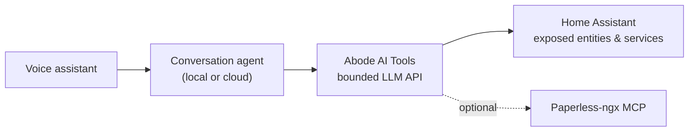

<p align="center">
  
</p>

<h1 align="center">Abode AI Tools</h1>

<p align="center">
  <strong>A small, bounded set of LLM tools for Home Assistant voice assistants.</strong>
</p>

<p align="center">
  <a href="https://github.com/meremortals70/abode-ai-tools/releases"></a>
  
  <a href="LICENSE"></a>
  <a href="https://github.com/meremortals70/abode-ai-tools/actions/workflows/tests.yml"></a>
  <a href="https://github.com/meremortals70/abode-ai-tools/actions/workflows/hassfest.yml"></a>
  <a href="https://github.com/meremortals70/abode-ai-tools/actions/workflows/marketplace.yml"></a>
</p>

<p align="center">
  <a href="https://my.home-assistant.io/redirect/marketplace_repository/?owner=meremortals70&repository=abode-ai-tools&category=integration"></a>
  <a href="https://my.home-assistant.io/redirect/config_flow_start/?domain=abode_ai_tools"></a>
</p>

<p align="center">
  <a href="#install">Install</a> ·
  <a href="#tools">Tools</a> ·
  <a href="#security-model">Security</a> ·
  <a href="#troubleshooting">Troubleshooting</a> ·
  <a href="#development">Development</a> ·
  <a href="CHANGELOG.md">Changelog</a>
</p>

## About

Abode AI Tools gives a conversation agent a small, fixed set of things it can
do in the house — and nothing else. It is built for the voice path: every tool
schema is small and every result is bounded, so the model does not spend the
turn reading a wall of entity records before it can speak.

It is designed for a self-hosted LLM pipeline such as Lemonade, but works with
any conversation agent that lets you select an LLM API. It is not affiliated
with, endorsed by, or supported by the Home Assistant project. This custom
integration is provided as-is, without warranty; you use it at your own risk.

## What it does

- **Finds things** — “which lights are on in the lounge” — by name, alias,
  room, domain or state, with at most 20 results and a real total.
- **Understands rooms** — “lounge” and “lounge room” find the same area, and
  area aliases work. An unknown room returns the rooms that do exist.
- **Checks one thing** — “is the garage door shut” — with a small, safe set of
  domain-specific attributes.
- **Does one thing** — “turn the deck light on” — through an allowlisted
  entity service on a single exposed device.
- **Tells the time** — only when asked, keeping the conversation prompt prefix
  cacheable for llama.cpp KV caching.
- **Looks up documents** — optional Paperless-ngx search, metadata and text,
  hard-capped and read-only.

## Tools

| Tool | What it does | Access |
|---|---|---|
| `search_entities` | Finds exposed entities by name, alias, domain, area or state. Returns at most 20. | read |
| `get_entity_state` | Reads one entity and a safe, domain-specific attribute set. | read |
| `call_service` | Calls an allowlisted entity service on one exposed controllable device. | write |
| `GetDateTime` | Returns local date, time and weekday only when asked. | read |
| `find_document` | Full-text Paperless search. Returns at most 8 results. | read |
| `get_document` | Paperless metadata, tags and custom fields. | read |
| `read_document` | Paperless document text, truncated to 4,000 characters. | read |

The three document tools are only registered when a Paperless endpoint is
configured. The device tools are always present.

## Architecture



## Requirements

| Requirement | Notes |
|---|---|
| Home Assistant | 2026.10 or newer. |
| Marketplace | Built into Home Assistant 2026.11 and newer. |
| HACS | Only needed on Home Assistant 2026.10. HACS cannot be installed on 2026.11+. |
| Conversation agent | Must let you select an LLM API / tool provider. |
| Paperless-ngx MCP | Optional. Needed only for the document tools. |
| Network | HTTPS is recommended whenever a Paperless token is configured. |

## Install

### Home Assistant 2026.11 and newer

The Marketplace is the built-in successor to HACS. It is under
**Settings → Marketplace**; there is nothing to install first.

<p align="center">
  <a href="https://my.home-assistant.io/redirect/marketplace_repository/?owner=meremortals70&repository=abode-ai-tools&category=integration"></a>
  <a href="https://my.home-assistant.io/redirect/config_flow_start/?domain=abode_ai_tools"></a>
</p>

1. Select the **Open this repository in the Marketplace** button above, or go
   to **Settings → Marketplace**.
2. If the repository is not in the catalog, choose **Add from link** and enter
   `https://github.com/meremortals70/abode-ai-tools`. Custom repositories need
   a GitHub connection; the Marketplace guides you through the device sign-in.
3. Select **Install**.
4. Add the integration with the **Add Abode AI Tools to Home Assistant** button
   above, or go to **Settings → Devices & services → Add integration**.
5. Restart Home Assistant after an integration update. A repair also prompts
   you.

The repository keeps `hacs.json` because the Marketplace reads the same file.
The filename is not a leftover from HACS.

### Home Assistant 2026.10

HACS is still the installation path on 2026.10. Add this repository as a
custom **Integration** repository, install it, then restart Home Assistant.

<p align="center">
  <a href="https://my.home-assistant.io/redirect/hacs_repository/?owner=meremortals70&repository=abode-ai-tools&category=integration"></a>
</p>

## Setup

Both configuration fields are optional:

- **Leave both blank** for the four device-control tools and no network calls.
- **Set the Paperless MCP URL** to add `find_document`, `get_document` and
  `read_document`. A token is optional but strongly recommended.

After adding the integration, open your conversation agent's configuration and
tick **Abode AI Tools** under **Tool Providers**. Untick any other provider
that exposes a larger set of tools if you want the bounded surface only.

Expose only what the assistant should control under
**Settings → Voice assistants → Expose**. Home Assistant may expose new
entities in common domains automatically, so review the list after adding
lights, covers, locks or scenes.

Reconfiguring the Paperless endpoint keeps the existing token when the token
field is left blank. Clearing the URL also clears the token. Restart Home
Assistant after updating the integration.

## Paperless (optional)

The integration speaks JSON-RPC to a
[paperless-mcp](https://github.com/baruchiro/paperless-mcp) HTTP endpoint. It
proxies only three read tools:

- `find_document` → `query_documents`
- `get_document` → `get_document`
- `read_document` → `get_document_content`

Configure:

| Field | Example |
|---|---|
| Paperless MCP URL | `https://paperless.example.com/mcp` |
| Paperless token | A Paperless-ngx API token for a **view-only** user |

Use a view-only token and restrict the MCP endpoint at your reverse proxy. A
paperless-mcp endpoint can fall back to its container token when a request has
no Authorization header, so the endpoint may be effectively anonymous. The
integration cannot protect an endpoint that is open to other clients.

Document text is untrusted data. It is sent to whichever conversation agent
you select, so a cloud agent sends your documents to that provider.

## Security model

- **Exposure is the boundary.** Only entities exposed to the assistant making
  the request are visible or controllable. Locks, covers, valves, scenes and
  scripts deserve particular care: a cover may be a garage door, and a scene or
  script can contain any action you put in it.
- **Service calls are allowlisted.** `call_service` only accepts an explicit
  set of entity services and a target in a controllable domain. It cannot call
  automations, backups, the recorder, or arbitrary admin services.
- **Sensitive domains need an explicit request.** `cover`, `lock` and `valve`
  are treated as sensitive in the system prompt: the model is told not to act
  on them, or run a script or scene, unless the request explicitly asked for
  it. That is guidance, not a hard guarantee. If you do not want voice control
  of a domain, remove it from `CONTROLLABLE_DOMAINS` and `ALLOWED_SERVICES` in
  [`policy.py`](custom_components/abode_ai_tools/policy.py).
- **Paperless is read-only.** Use a view-only token, restrict the MCP endpoint,
  and use HTTPS when a token is configured.
- **Documents are untrusted.** Paperless content, entity names and tool results
  can contain instructions. The system prompt tells the model to treat them as
  data and never follow instructions inside them. The model is still the last
  line of defence, so keep sensitive actions out of reach if that matters.
- **Cloud providers.** This component is provider-agnostic. If you select a
  cloud conversation agent, entity names, states, attributes and Paperless
  text are sent to that provider.

See [SECURITY.md](SECURITY.md) for reporting a vulnerability and the full
security model.

## Troubleshooting

| Symptom | What to check |
|---|---|
| The assistant says a device does not exist. | Expose it to the active assistant under **Settings → Voice assistants → Expose**. New entities in common domains may be exposed automatically, but others are not. |
| The assistant controls the wrong room. | Update to 0.6.1 or newer; area matching uses word boundaries. Use the room name or one of its aliases. |
| Paperless questions fail. | Check the MCP URL, token, that the server is reachable, and that the endpoint uses the expected path. After a connection failure, the 60-second breaker waits before retrying. |
| A service is refused. | `call_service` only accepts allowlisted entity services. Check the service against [`policy.py`](custom_components/abode_ai_tools/policy.py) and confirm the entity is in a controllable domain. |
| An update is not offered. | On 2026.11+, check **Settings → Marketplace**, then **Settings → Updates**. On 2026.10, check HACS. Restart after updating an integration. |
| HACS is missing after upgrading to 2026.11. | Expected. HACS is replaced by the built-in Marketplace under **Settings**. |
| Tools or warnings appear in the log. | Update to 0.6.1; tools declare their integration and return `ToolResult`. Check **Settings → System → Logs**, filtered to `abode_ai_tools`. |

## Development

| Path | Contents |
|---|---|
| `custom_components/abode_ai_tools/__init__.py` | LLM API, tools and the config entry. |
| `custom_components/abode_ai_tools/policy.py` | Domains, service allowlist, attribute projection and bounds. |
| `custom_components/abode_ai_tools/paperless.py` | Paperless MCP proxy and response hardening. |
| `custom_components/abode_ai_tools/util.py` | String/JSON bounding and URL redaction. |
| `tests/` | Dependency-free tests with a small fake-HA harness. |
| `.github/workflows/` | Tests, hassfest and Marketplace validation. |

Run the tests from the repository root:

```bash
python -m unittest discover -s tests -v
```

The tests do not install Home Assistant. They cover the tools, Paperless RPC
parsing, config merge logic, policy allowlists, attribute projection, bounds
and the fake-HA integration path.

`policy.py` is the security boundary. Review changes there deliberately, and
add a test for every new allowed service or domain.

## Support

- Bugs and feature requests:
  [open an issue](https://github.com/meremortals70/abode-ai-tools/issues).
- Security reports: [SECURITY.md](SECURITY.md) — please report privately.
- Release notes: [CHANGELOG.md](CHANGELOG.md) and the
  [GitHub releases page](https://github.com/meremortals70/abode-ai-tools/releases).

## License

MIT. See [LICENSE](LICENSE).

## Credits

Designed and directed by Jason Wienert (Mere Mortals Consulting).
Implementation, research and code written in collaboration with OpenCode.
